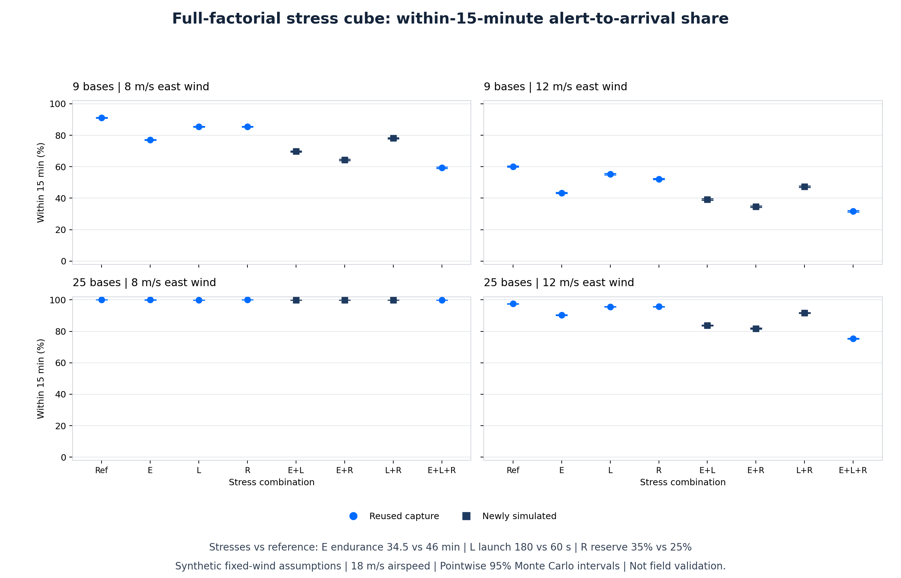
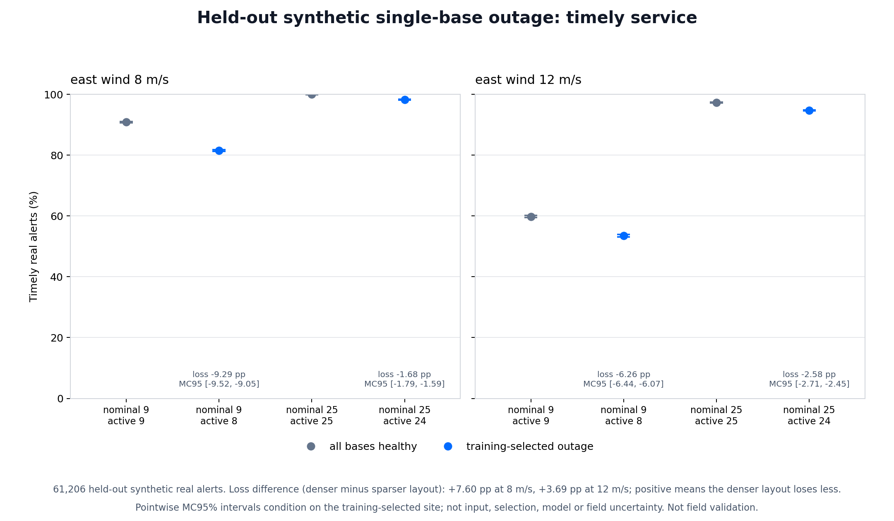
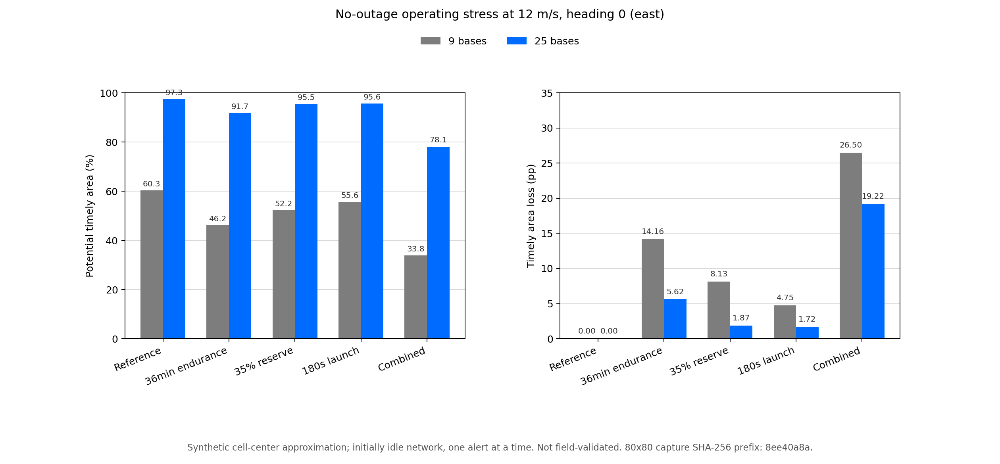

# Wildfire sweep

**Research prototype** · **Python 3.10+** · **Local CPU**

A reproducible research baseline for studying how docked UAV networks verify externally reported wildfire alerts under wind, endurance and operating-cost constraints.


## Contents

- [Research question](#research-question)
- [What is implemented](#what-is-implemented)
- [System architecture](#system-architecture)
- [Captured anchor](#captured-anchor)
- [Assumption stress study](#assumption-stress-study)
- [Factorial extension](#factorial-extension)
- [Held-out outage resilience](#held-out-outage-resilience)
- [Mission Lab](#mission-lab)
- [Coverage Atlas](#coverage-atlas)
- [Reproduce](#reproduce)
- [Recorded-video baseline](#recorded-video-baseline)
- [Repository map](#repository-map)
- [Evidence and limitations](#evidence-and-limitations)
- [Proposed field protocol](#proposed-field-protocol)
- [Dataset entrypoints](#dataset-entrypoints)
- [Licensing and references](#licensing-and-references)

## Research question

> How much network density is needed to keep alert-to-arrival service useful as wind increases?

The project studies a docked fleet's response after an external alert arrives. It separates the dispatch simulation from the recorded-video color baseline and from any future field workflow.

## What is implemented

| Implemented in this repository | Proposed or not implemented |
| --- | --- |
| Synthetic wind-aware dispatch with fleet contention and battery-reserve constraints. | Live external-alert integration or upstream detector latency. |
| Held-out network-resilience study with training-selected single-base outages. | Measured outage probabilities, optimal real sites or equal-budget optimization. |
| A local RGB color/persistence baseline for recorded video. | Smoke detection, thermal inference, or a calibrated fire probability. |
| Sampled event-episode evaluation plus a cohort registry, pooled aggregation and cluster-bootstrap interval mechanics over captured reports. | Independently labelled recordings, verified group independence, or detector accuracy evidence. |
| A summary renderer that reads captured CSV values and refuses existing output paths. | An autonomous thermal confirmation-and-mapping pipeline. |
| Captured manifests, scenario summaries, season rows, and a proposed field protocol. | Live aircraft control, deployment, or flight authorization. |
| A local Mission Lab for one-alert sandbox requests and frozen-season replay. | Field performance, detector accuracy, or flight control. |

## System architecture

The first lane is a conceptual research workflow, not a deployed integration. External alert is an assumed input; dispatch is simulated; thermal confirmation and mapping are a proposed field workflow; human review remains an operator decision. No camera or satellite is integrated as a live alert source.


The recorded-video baseline is deliberately separate. It processes local RGB samples; it is not the upstream live detector assumed by the dispatch simulation.

## Captured anchor

The published anchor is frozen under [`research_results/2026-11-07-anchor/`](research_results/2026-11-07-anchor/):

- [Manifest](research_results/2026-11-07-anchor/manifest.json)
- [Scenario summary](research_results/2026-11-07-anchor/summary.csv)
- [Season rows](research_results/2026-11-07-anchor/seasons.csv)
- [Service chart](research_results/2026-11-07-anchor/service.png)

The manifest records a 3,808 km² domain, 307 expected real ignitions per season, false-alarm fraction 0.15, 60 s launch latency, 46 min airborne endurance with 25% reserve, maximum model wind 12 m/s, airspeeds 18 and 20 m/s, and fixed winds 0, 4, 8 and 12 m/s. The captured anchor has 36 scenarios: 4 legacy and 32 physical, each with 200 seasons and 61,538 real alerts. Scenarios share common random inputs; alerts are not independent across all 36 scenarios. That alert count describes this captured anchor, not every future run.

The response metric is pooled nearest-rank alert-receipt-to-drone-arrival time. It excludes upstream detector latency, is event-weighted, and retains rejected alerts in the denominator. Its p90 is not interchangeable with the historical frontier's mean-of-season p90 or with its other launch settings.


| Physical scenario | Within 15 min | Model cost |
| --- | ---: | ---: |
| 9 bases, 1 drone/base; 18 m/s airspeed, 0 m/s wind | 99.76% | 100.98 EUR/km²/yr |
| 9 bases, 1 drone/base; 18 m/s airspeed, 8 m/s wind | 91.08% | 100.98 EUR/km²/yr |
| 9 bases, 1 drone/base; 18 m/s airspeed, 12 m/s wind | 60.11% | 100.98 EUR/km²/yr |
| 25 bases, 1 drone/base; 18 m/s airspeed, 12 m/s wind | 97.51% | 252.48 EUR/km²/yr |

At 12 m/s wind, physical rejections are 16.40% for the 9-base scenario and 0% for the 25-base scenario. For 9 bases at 18 m/s airspeed and 12 m/s wind, pooled p90 is unreachable/infinite because rejected alerts remain in the denominator.

<details>
<summary>Earlier analyses and captured charts</summary>


*Historical flat-flight cost/response sweep, not the wind-aware study.*


*Exploratory suppression feasibility with placeholder costs, not validated fire suppression.*
</details>

At zero wind, physical results can differ slightly from legacy: battery constraints can prevent distant fallback-base dispatch while nearby drones are busy. With unbounded endurance, physical mode matches legacy.

The 95% intervals use 1,000 season-cluster bootstrap draws. They represent Monte Carlo sampling uncertainty only, not input, model, or cost uncertainty.

## Assumption stress study

A second [captured study](research_results/2026-11-08-robustness/) tests shorter endurance, slower launches and larger reserves. It contains 20 scenarios over 200 shared synthetic seasons, with 61,084 real alerts per scenario and 26 paired comparisons.

| Bases | Fixed wind | Reference timely share | Combined-stress timely share |
| --- | ---: | ---: | ---: |
| 9 | 8 m/s | 91.04% | 59.36% |
| 25 | 8 m/s | 99.99% | 99.85% |
| 9 | 12 m/s | 60.10% | 31.67% |
| 25 | 12 m/s | 97.48% | 75.34% |

Combined stress assumes 34.5 min endurance, 35% reserve and 180 s launch latency, versus 46 min, 25% and 60 s in the reference. Airspeed is 18 m/s throughout. These stress values are hypothetical, not measured derating or operating advice.


Density still helps, but the result depends strongly on operating assumptions. At 12 m/s under combined stress, pooled p90 is unreachable/infinite for both layouts. Read the [methods, paired intervals, limitations and resume-safe project description](docs/2026-11-08-robustness-study.md). Intervals describe Monte Carlo sampling error only.

## Factorial extension

The [full-factorial extension](docs/2026-11-08-factorial-study.md) completes all eight combinations of endurance, launch-latency and reserve stress in each of the four layout/wind contexts. It reuses the 20 frozen scenarios and simulates only the 12 missing pairwise-stress combinations, giving 32 cells and 28 main/interaction contrasts. It uses the same source alerts, not an independent replication.



At 25 bases and fixed 12 m/s wind, the endurance/reserve interaction is **-5.56 percentage points** (pointwise 95% Monte Carlo interval: -5.83 to -5.30), averaged over launch settings. Constraints do not combine additively, and the interaction changes with context.

The [protocol](factorial_protocol.json) defines the estimator before execution. Main contrasts average over the other factors; pair terms are full differences-in-differences, not half-scaled DOE effects. Pointwise Monte Carlo intervals do not establish field performance or cover input/model uncertainty. See the [research roadmap](docs/research-roadmap.md) for evidence still needed.

## Held-out outage resilience

The next research question is structural: what happens when a critical base is unavailable?

Thirty training seasons identify a critical site separately for each layout/wind. The selections are frozen before generating **200 fresh held-out seasons**, containing **61,206 simulated true alerts**. Healthy and single-site-outage cases use the same alerts and unchanged flight model.

| Nominal bases | Fixed east wind | Healthy within 15 min | One-base outage | Change |
| ---: | ---: | ---: | ---: | ---: |
| 9 | 8 m/s | 90.88% | 81.59% | -9.29 pp |
| 25 | 8 m/s | 99.99% | 98.31% | -1.68 pp |
| 9 | 12 m/s | 59.81% | 53.55% | -6.26 pp |
| 25 | 12 m/s | 97.33% | 94.75% | -2.58 pp |



At 12 m/s, the denser layout loses **3.69 percentage points less service** (pointwise MC95%: 3.49 to 3.87). It also has more infrastructure and loses a smaller fraction of its fleet: 25 becomes 24 active bases, versus 9 becoming 8. This is not an equal-budget or per-aircraft superiority claim.

Read the [methods, site maps, intervals and limitations](docs/2026-11-09-resilience-study.md), [protocol](resilience_protocol.json) and [frozen capture](research_results/2026-11-09-resilience/). A training-selected critical site is not necessarily the held-out worst site. No observed failure probability, actual geographic siting or field performance is established.

## Mission Lab

Start the local interface:

```sh
.venv/bin/python simulator_server.py
```

Open [http://127.0.0.1:8765](http://127.0.0.1:8765) and see the [local simulator guide](docs/local-simulator.md).

The sandbox evaluates one alert with initially idle drones. Frozen replay reads recorded seasons that include fleet contention; the capture contains no saved base assignments or flight trajectories, so the map retains captured base sites and shows alert locations and outcomes without assigned routes. Sandbox inputs never change frozen evidence. This adds no empirical finding, field validation, detector-accuracy claim, or live flight control.

The interface can also save the current session inputs to a local JSON file and restore them later. A saved session records validated inputs and provenance only, never received results; restoring issues a fresh local request, and the saved provenance must match the running catalog before anything is applied. In replay mode, a captured healthy/outage pair that shares layout and wind can render side by side on one shared playback clock. See the [local simulator guide](docs/local-simulator.md) for behavior and limits.

Mechanics tests for the pure browser modules are optional and run under the standalone Node.js test runner, separate from the Python suite:

```sh
node --test simulator_web/tests/
```

## Coverage Atlas

The same local server also serves a captured spatial-coverage explorer. With the server running, open [http://127.0.0.1:8765/coverage/](http://127.0.0.1:8765/coverage/).

The atlas reads a lead-generated capture (default `research_results/2026-11-10-coverage-atlas-v1`) of 388 bounded scenarios evaluated on an 80x80 grid of equal-area cell centers. Coverage is the fraction of those cell centers reached within 900 seconds by an initially idle network after one alert. It is a spatial cell-center approximation, not the season-level timely shares reported above, and not an ignition-risk estimate, forecast, detector result, geographic map or field-performance claim. The inventory is fixed, not exhaustive: 9- and 25-base layouts crossed with eight headings at the 12 m/s model weather limit, each with a healthy reference and every single-site outage (288 scenarios); two selected outage pairs per heading and layout (32; not a worst-pair search); four healthy stress profiles of 36 min endurance, 35% reserve and 180 s launch latency (64); plus two calm reference cases and two 13 m/s weather-closed cases.

See the [coverage study report](docs/2026-11-10-coverage-study.md), [methods and limitations](docs/coverage-atlas.md), and [scenario inventory](docs/coverage-scenario-inventory.md). At 12 m/s toward east (heading 0), stored reference coverage is 60.3% for 9 bases and 97.3% for 25; the combined stress profile stores 33.8% and 78.1%, respectively. These are spatial cell-center values, not season-level shares.



The CLI prints the same catalog and per-case payloads served at `/api/coverage/catalog` and `/api/coverage?case=ID`:

```sh
.venv/bin/python coverage_client.py --base-url http://127.0.0.1:8765 catalog
.venv/bin/python coverage_client.py --base-url http://127.0.0.1:8765 case --case CASE_ID
```

`--base-url` accepts the same loopback addresses as `simulator_client.py`. An escaped Markdown inventory of an existing capture can also be rendered to a fresh output path:

```sh
.venv/bin/python render_coverage.py --capture research_results/2026-11-10-coverage-atlas-v1 --output research-runs/atlas-inventory.md
```

The capture directory must already exist; a missing or corrupt capture is reported as unavailable, and no interface here regenerates it. Node mechanics tests are optional locally; CI requires both browser-module suites on Node 22:

```sh
node --test simulator_web/tests/ coverage_web/tests/
```

## Reproduce

### Inspect the frozen capture

The published summary and chart are already available above. Inspecting them does not require rerunning the study.

### Start a new study

Use Python 3.10 or newer. These commands create a fresh local environment and output directory:

The full test suite also requires externally installed FFmpeg on your command path; Python dependencies alone are insufficient.

```sh
python3 -m venv .venv
.venv/bin/python -m pip install -r requirements.txt
.venv/bin/python -m unittest discover -v
.venv/bin/python research.py --output research-runs/my-study --seasons 200
```

Each new run must use a fresh output directory. The study writes its manifest, summary and season rows there. Do not overwrite frozen captures.

### Render a new summary

The renderer reads existing values only; it does not import the research or historical model scripts, derive metrics, or overwrite an existing PNG. Its output parent must already exist.

```sh
.venv/bin/python render_study.py research-runs/my-study/summary.csv --output research-runs/my-study/service.png
```

### Run a new assumption stress study

```sh
.venv/bin/python robustness.py --output research-runs/my-robustness --seasons 200 --seed 20261108
.venv/bin/python render_robustness.py research-runs/my-robustness/summary.csv --output research-runs/my-robustness/stress.png
```

Both commands require fresh output paths. `make verify` runs the full local tests and historical self-checks.

### Complete the factorial design

```sh
.venv/bin/python factorial.py --output research-runs/my-factorial
.venv/bin/python render_factorial.py research-runs/my-factorial/summary.csv --output research-runs/my-factorial/factorial.png
```

The default source is the frozen `research_results/2026-11-08-robustness` capture. Retain it for complete replay. Both commands require fresh output paths.

### Historical self-checks

The original sweep scripts remain available for provenance. Their `--check` modes are self-checks, not field validation:

```sh
.venv/bin/python sweep.py --check
.venv/bin/python suppression.py --check
.venv/bin/python sensitivity.py --check
```

### Verify a capture's listed bytes

The additive integrity layer checks that the files a complete schema-v1 `manifest.json` lists still hash to their declared digests, then emits a fresh receipt. It runs no detector, evaluation, simulation or renderer code.

```sh
.venv/bin/python verify_capture.py CAPTURE_DIR
.venv/bin/python verify_capture.py CAPTURE_DIR --output research-runs/NEW_RECEIPT.json
```

The output path is checked before any input is read; its parent must exist and the receipt file must be new. A verified receipt means the listed bytes did not change; it is no evidence of completeness, authenticity, label truth, split independence, detector accuracy or scientific validity. Semantics and limits are in the [capture-integrity quickstart](docs/2026-11-09-capture-integrity.md).

## Recorded-video baseline

`video_io.py` decodes local video through externally installed FFmpeg into resampled 640x360 RGB frames with normalized aspect ratio. Default sampling is 1 fps, capped at 600 frames.

```sh
.venv/bin/python detection.py LOCAL_VIDEO --output research-runs/my-video --recording-id event-001
```

Optional labels:

```sh
.venv/bin/python detection.py LOCAL_VIDEO --output research-runs/my-video-labelled --recording-id event-001 --labels labels.csv
```

The label CSV header is `recording_id,sample_index,fire,split`. Labels must cover every decoded sampled index exactly once; `sample_index` is not the original source-frame index. Hold out entire recordings for `split=test`; never split frames from one recording across partitions.

This is an assumed-threshold RGB color/persistence baseline, not smoke detection, thermal inference, or a calibrated probability. It can miss smoke, obscured, small, and distant fires, and can flag orange objects or sunlight. No detector accuracy result exists here.

The processed FLAME demo is an I/O smoke test only. Its published [manifest](research_results/flame-demo/manifest.json), [predictions](research_results/flame-demo/predictions.csv), and [provenance](research_results/flame-demo/provenance.json) contain no labels or accuracy evidence. Do not redistribute the footage.

### Event-episode evaluation


The additive [`event_protocol.json`](event_protocol.json) workflow evaluates sampled visible-fire episodes on one fully labelled test recording. The split must be assigned before annotation; only a `test` packet may be evaluated.

```sh
.venv/bin/python annotation_packet.py LOCAL_VIDEO --recording-id event-001 --split test --sample-fps 1 --max-frames 600 --output research-runs/my-annotation
```

The packet is blinded: contact sheets plus a `labels.csv` with every `fire` cell blank, and no scores or predictions. A human reviewer completes a separate copy of `labels.csv`; the original packet is retained. There is no automated labelling and no fabricated human labels. Blank or uncertain cells fail evaluation rather than being excluded.

```sh
.venv/bin/python detection.py LOCAL_VIDEO --output research-runs/my-predictions --recording-id event-001 --sample-fps 1 --max-frames 600

.venv/bin/python event_evaluation.py --predictions research-runs/my-predictions --packet research-runs/my-annotation --labels COMPLETED_LABELS.csv --annotator-id reviewer-01 --output research-runs/my-events
```

Each command requires a fresh output path and captures provenance (input, artifact and source hashes; sampled times). The evaluator reports episode counts, recall, alarm precision, false onsets per non-fire exposure hour, detected-onset delays and censor flags; zero denominators report null. It emits no confidence intervals, pass/fail verdict or incident-level recall. Metric semantics and limits are in the [video-evaluation quickstart](docs/2026-11-08-video-evaluation.md).

### Cohort evaluation


The additive [`cohort_protocol.json`](cohort_protocol.json) workflow aggregates captured single-recording event reports over a declared cohort. It adds registry, pooled-metric and cluster-bootstrap mechanics only; it supplies no independent data, detector accuracy results or acceptance verdict.

`COHORT.csv` uses exactly this seven-column header, declared before review; column semantics are in the quickstart:

```csv
recording_id,cluster_id,site_id,capture_date,split,packet_dir,event_report_dir
```

```sh
.venv/bin/python cohort_registry.py COHORT.csv --output research-runs/my-cohort-registry
.venv/bin/python cohort_evaluation.py research-runs/my-cohort-registry --output research-runs/my-cohort-results --seed 20261109
.venv/bin/python render_cohort.py research-runs/my-cohort-results/summary.csv --output research-runs/my-cohort-results/cohort.png
```

The freeze binds blank annotation packets and planned test report paths; human labels, baseline captures and `event_evaluation.py` reports then land at those paths before aggregation. Registry and evaluation commands capture hashes and provenance; the renderer reads summary.csv only. Every output path must be fresh. Semantics and limits are in the [cohort-evaluation quickstart](docs/2026-11-09-cohort-evaluation.md).

## Repository map

| Path | Role |
| --- | --- |
| [`research.py`](research.py) | Current synthetic wind-and-battery dispatch study. |
| [`robustness.py`](robustness.py) and [`robustness_protocol.json`](robustness_protocol.json) | Paired assumption-stress study and its fixed protocol. |
| [`factorial.py`](factorial.py) and [`factorial_protocol.json`](factorial_protocol.json) | Full-factorial extension and its fixed estimator protocol. |
| [`simulator_engine.py`](simulator_engine.py) and [`simulator_data.py`](simulator_data.py) | Single-alert sandbox engine and verified frozen-season reader. |
| [`simulator_server.py`](simulator_server.py), [`simulator_client.py`](simulator_client.py), and [`simulator_web/`](simulator_web/) | Local Mission Lab API, CLI and browser modules, including JSON export. |
| [`docs/local-simulator.md`](docs/local-simulator.md) | Mission Lab commands, modes and limitations. |
| [`test_simulator_server.py`](test_simulator_server.py), [`test_simulator_assets.py`](test_simulator_assets.py) and [`test_simulator_client.py`](test_simulator_client.py) | Local transport, static-asset and CLI tests. |
| [`render_study.py`](render_study.py) | Renderer for an existing captured summary. |
| [`render_robustness.py`](render_robustness.py) | Capture-only renderer for the robustness summary. |
| [`render_factorial.py`](render_factorial.py) | Capture-only renderer for the full-factorial summary. |
| [`video_io.py`](video_io.py) and [`detection.py`](detection.py) | Local recorded-video adapter and exploratory RGB baseline. |
| [`annotation_packet.py`](annotation_packet.py), [`event_evaluation.py`](event_evaluation.py) and [`event_protocol.json`](event_protocol.json) | Blinded annotation packets, sampled event-episode evaluation and the fixed protocol. |
| [`cohort_registry.py`](cohort_registry.py), [`cohort_evaluation.py`](cohort_evaluation.py) and [`cohort_protocol.json`](cohort_protocol.json) | Frozen cohort registry with leakage guards, pooled metrics and seeded cluster-bootstrap intervals; fixed aggregation protocol. |
| [`render_cohort.py`](render_cohort.py) | Capture-only renderer for a cohort summary. |
| [`capture_integrity.py`](capture_integrity.py) and [`verify_capture.py`](verify_capture.py) | Byte-integrity receipt layer and CLI for listed capture artifacts. |
| [`sweep.py`](sweep.py), [`suppression.py`](suppression.py), [`sensitivity.py`](sensitivity.py) | Historical analyses and their self-checks. |
| [`test_research.py`](test_research.py), [`test_robustness.py`](test_robustness.py), [`test_robustness_results.py`](test_robustness_results.py), [`test_render_robustness.py`](test_render_robustness.py), and other `test_*.py` files | Tests for model mechanics, paired stress analysis, renderer validation, I/O, and frozen capture integrity. |
| [`field_protocol.json`](field_protocol.json) | Proposed evidence protocol; not flight authorization. |
| [`requirements.txt`](requirements.txt) | Direct Python dependencies. FFmpeg is external. |
| [`pareto.png`](pareto.png), [`suppression.png`](suppression.png); local `results.csv`, `suppression.csv` | Historical plots are included. Ignored root CSV outputs may exist locally but are not included in a fresh clone. |
| [`research_results/2026-11-07-anchor/`](research_results/2026-11-07-anchor/) | Published frozen anchor evidence. |
| [`research_results/2026-11-08-robustness/summary.csv`](research_results/2026-11-08-robustness/summary.csv) | Published frozen assumption-stress capture and rendered chart. |
| [`research_results/2026-11-08-factorial/`](research_results/2026-11-08-factorial/) | Full-factorial extension capture and rendered chart. |
| `research-runs/` | Ignored local output area for new, non-overwriting runs. |
| [`docs/2026-11-08-video-evaluation.md`](docs/2026-11-08-video-evaluation.md) | Recorded-video event-evaluation quickstart. |
| [`docs/2026-11-09-cohort-evaluation.md`](docs/2026-11-09-cohort-evaluation.md) | Cohort registry and evaluation quickstart. |
| [`docs/2026-11-09-capture-integrity.md`](docs/2026-11-09-capture-integrity.md) | Capture byte-integrity quickstart. |
| [`docs/data-collection-checklist.md`](docs/data-collection-checklist.md) | Software-side collection and handoff checklist. |
| [`docs/responsible-data-handling.md`](docs/responsible-data-handling.md) | Handling notes for recordings, labels and rights records. |
| [`docs/reproducibility-runbook.md`](docs/reproducibility-runbook.md) | Runbook for reproducing checks, captures and receipts. |
| [`docs/research-project-brief.md`](docs/research-project-brief.md) | One-page project description and evidence summary. |
| [`docs/`](docs/) | Historical build and research notes. |

## Evidence and limitations

- Fixed-wind synthetic scenarios are not forecast weather availability and are not field accuracy.
- Constant airspeed and time budgets are not validated power, drag, terrain, gust, or measured battery-energy models.
- Upstream detection is assumed before alert receipt. Its latency and missed alerts are outside the dispatch model.
- The recorded-video lane includes sampled event-episode and cohort-aggregation mechanics, but no independently labelled evaluation exists; cluster-bootstrap intervals remain conditional on declared groups and do not verify independence or establish detector accuracy.
- A p90 that is unreachable/infinite is a result of retaining rejected alerts in the pooled denominator.
- Field measurements, safety evidence, and regulatory approval are separate future gates.

## Proposed field protocol

[`field_protocol.json`](field_protocol.json) is proposed research scope, not passed acceptance, license to fly, or flight authorization. It calls for a recorded-data baseline before authorized VLOS measurements, then a calibrated network study only after measured inputs are locked with provenance.

Proposed recorded-data targets include at least 20 independent fire and 20 no-fire recordings across 3 sites and 2 capture dates, plus 2 negative-video hours. The protocol proposes event recall of at least 0.90, at most 1 false-alarm episode per negative-video hour, and p90 event-detection delay at most 10 s. These are targets, not results; sampled event matching and episode mechanics are implemented, but they have not been run on independently labelled data.

Any flight work requires a qualified operator, site approval, and a site-specific risk assessment. The protocol explicitly excludes intentionally ignited fires, suppression drops, public emergency deployment, and BVLOS until applicable authorization. Vendor endurance and wind ratings are upper limits, not routine planning targets.

## Dataset entrypoints

Candidate sources only. Check dataset-specific terms before acquisition; no datasets or model weights are bundled or downloaded.

- **FLAME 3:** [paper](https://arxiv.org/abs/2412.02831) and [IEEE DataPort](https://ieee-dataport.org/open-access/flame-3-radiometric-thermal-uav-imagery-wildfire-management). Single-burn imagery cannot establish cross-site generalization.
- **Original FLAME:** [repository](https://github.com/AlirezaShamsoshoara/Fire-Detection-UAV-Aerial-Image-Classification-Segmentation-UnmannedAerialVehicle) and [IEEE DataPort](https://ieee-dataport.org/open-access/flame-dataset-aerial-imagery-pile-burn-detection-using-drones-uavs). The repository README restricts academic/non-commercial use while its LICENSE reports GPL-2.0; verify dataset terms independently.

## Licensing and references

No project license file is present; this README does not select or imply a project license. No DOI or publication is assigned. Third-party dataset, repository, and processed-media terms remain separate; verify them before use or redistribution.
