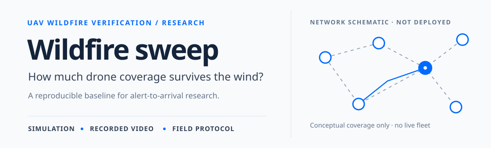
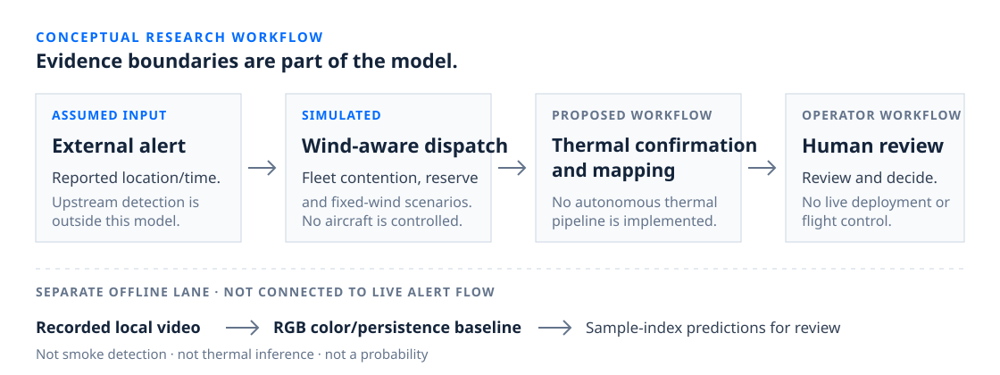
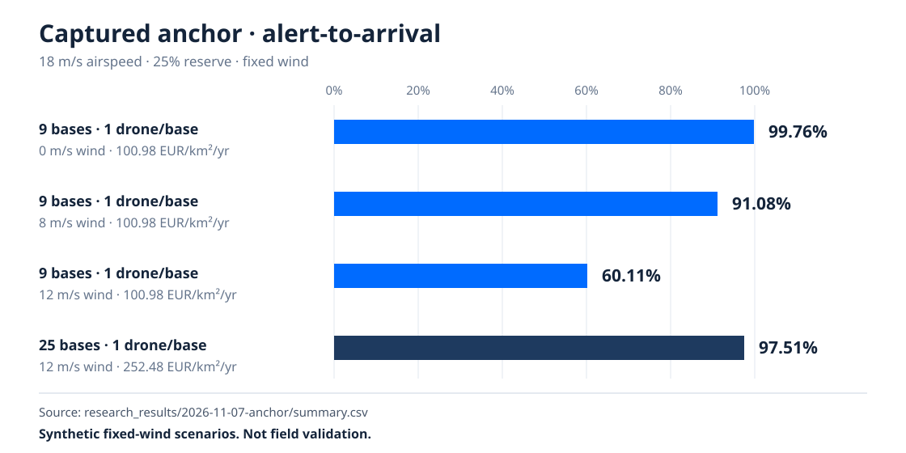
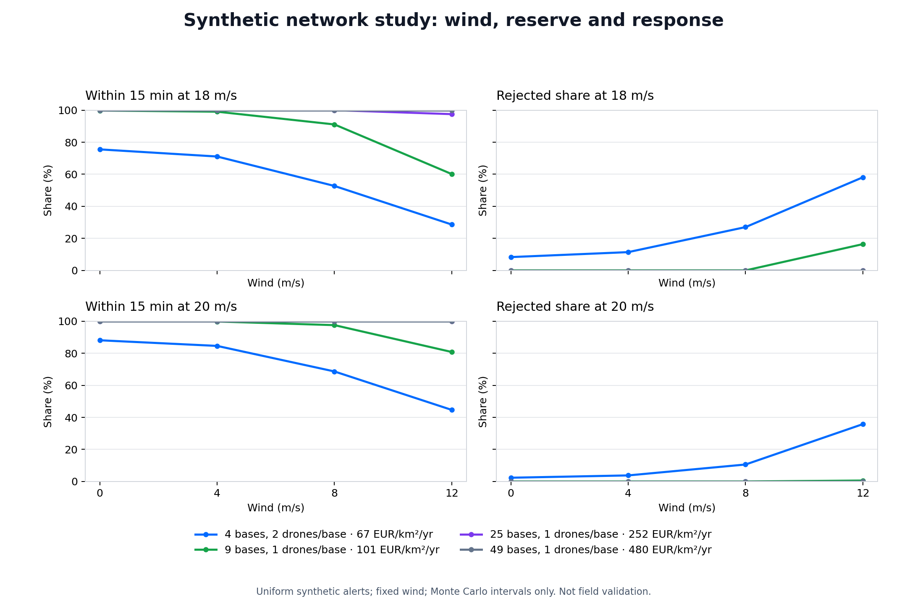
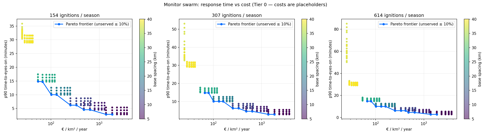
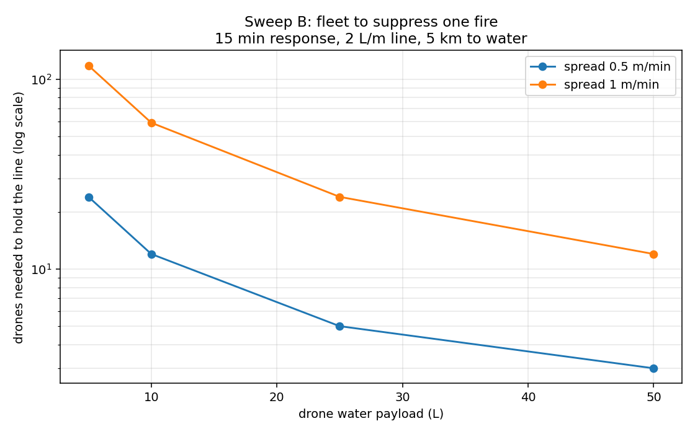
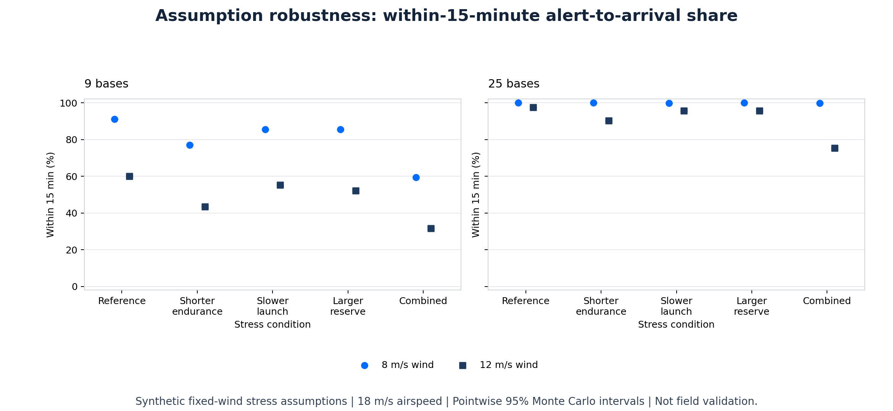

# Wildfire sweep

**Research prototype** · **Python 3.10+** · **Local CPU**

A reproducible research baseline for studying how docked UAV networks verify externally reported wildfire alerts under wind, endurance and operating-cost constraints.



## Contents

- [Research question](#research-question)
- [What is implemented](#what-is-implemented)
- [System architecture](#system-architecture)
- [Captured anchor](#captured-anchor)
- [Assumption stress study](#assumption-stress-study)
- [Reproduce](#reproduce)
- [Recorded-video baseline](#recorded-video-baseline)
- [Repository map](#repository-map)
- [Evidence and limitations](#evidence-and-limitations)
- [Proposed field protocol](#proposed-field-protocol)
- [Dataset entrypoints](#dataset-entrypoints)
- [Licensing and references](#licensing-and-references)

## Research question

> How much network density is needed to keep alert-to-arrival service useful as wind increases?

The project studies a docked fleet's response after an external alert arrives. It separates the dispatch simulation from the recorded-video color baseline and from any future field workflow.

## What is implemented

| Implemented in this repository | Proposed or not implemented |
| --- | --- |
| Synthetic wind-aware dispatch with fleet contention and battery-reserve constraints. | Live external-alert integration or upstream detector latency. |
| A local RGB color/persistence baseline for recorded video. | Smoke detection, thermal inference, or a calibrated fire probability. |
| A summary renderer that reads captured CSV values and refuses existing output paths. | An autonomous thermal confirmation-and-mapping pipeline. |
| Captured manifests, scenario summaries, season rows, and a proposed field protocol. | Live aircraft control, deployment, or flight authorization. |

## System architecture

The first lane is a conceptual research workflow, not a deployed integration. External alert is an assumed input; dispatch is simulated; thermal confirmation and mapping are a proposed field workflow; human review remains an operator decision. No camera or satellite is integrated as a live alert source.



The recorded-video baseline is deliberately separate. It processes local RGB samples; it is not the upstream live detector assumed by the dispatch simulation.

## Captured anchor

The published anchor is frozen under [`research_results/2026-11-07-anchor/`](research_results/2026-11-07-anchor/):

- [Manifest](research_results/2026-11-07-anchor/manifest.json)
- [Scenario summary](research_results/2026-11-07-anchor/summary.csv)
- [Season rows](research_results/2026-11-07-anchor/seasons.csv)
- [Service chart](research_results/2026-11-07-anchor/service.png)

The manifest records a 3,808 km² domain, 307 expected real ignitions per season, false-alarm fraction 0.15, 60 s launch latency, 46 min airborne endurance with 25% reserve, maximum model wind 12 m/s, airspeeds 18 and 20 m/s, and fixed winds 0, 4, 8 and 12 m/s. The captured anchor has 36 scenarios: 4 legacy and 32 physical, each with 200 seasons and 61,538 real alerts. Scenarios share common random inputs; alerts are not independent across all 36 scenarios. That alert count describes this captured anchor, not every future run.

The response metric is pooled nearest-rank alert-receipt-to-drone-arrival time. It excludes upstream detector latency, is event-weighted, and retains rejected alerts in the denominator. Its p90 is not interchangeable with the historical frontier's mean-of-season p90 or with its other launch settings.



| Physical scenario | Within 15 min | Model cost |
| --- | ---: | ---: |
| 9 bases, 1 drone/base; 18 m/s airspeed, 0 m/s wind | 99.76% | 100.98 EUR/km²/yr |
| 9 bases, 1 drone/base; 18 m/s airspeed, 8 m/s wind | 91.08% | 100.98 EUR/km²/yr |
| 9 bases, 1 drone/base; 18 m/s airspeed, 12 m/s wind | 60.11% | 100.98 EUR/km²/yr |
| 25 bases, 1 drone/base; 18 m/s airspeed, 12 m/s wind | 97.51% | 252.48 EUR/km²/yr |

At 12 m/s wind, physical rejections are 16.40% for the 9-base scenario and 0% for the 25-base scenario. For 9 bases at 18 m/s airspeed and 12 m/s wind, pooled p90 is unreachable/infinite because rejected alerts remain in the denominator.

<details>
<summary>Earlier analyses and captured charts</summary>




*Historical flat-flight cost/response sweep, not the wind-aware study.*


*Exploratory suppression feasibility with placeholder costs, not validated fire suppression.*
</details>

At zero wind, physical results can differ slightly from legacy: battery constraints can prevent distant fallback-base dispatch while nearby drones are busy. With unbounded endurance, physical mode matches legacy.

The 95% intervals use 1,000 season-cluster bootstrap draws. They represent Monte Carlo sampling uncertainty only, not input, model, or cost uncertainty.

## Assumption stress study

A second [captured study](research_results/2026-11-08-robustness/) tests shorter endurance, slower launches and larger reserves. It contains 20 scenarios over 200 shared synthetic seasons, with 61,084 real alerts per scenario and 26 paired comparisons.

| Bases | Fixed wind | Reference timely share | Combined-stress timely share |
| --- | ---: | ---: | ---: |
| 9 | 8 m/s | 91.04% | 59.36% |
| 25 | 8 m/s | 99.99% | 99.85% |
| 9 | 12 m/s | 60.10% | 31.67% |
| 25 | 12 m/s | 97.48% | 75.34% |

Combined stress assumes 34.5 min endurance, 35% reserve and 180 s launch latency, versus 46 min, 25% and 60 s in the reference. Airspeed is 18 m/s throughout. These stress values are hypothetical, not measured derating or operating advice.



Density still helps, but the result depends strongly on operating assumptions. At 12 m/s under combined stress, pooled p90 is unreachable/infinite for both layouts. Read the [methods, paired intervals, limitations and resume-safe project description](docs/2026-11-08-robustness-study.md). Intervals describe Monte Carlo sampling error only.

## Reproduce

### Inspect the frozen capture

The published summary and chart are already available above. Inspecting them does not require rerunning the study.

### Start a new study

Use Python 3.10 or newer. These commands create a fresh local environment and output directory:

```sh
python3 -m venv .venv
.venv/bin/python -m pip install -r requirements.txt
.venv/bin/python -m unittest discover -v
.venv/bin/python research.py --output research-runs/my-study --seasons 200
```

Each new run must use a fresh output directory. The study writes its manifest, summary and season rows there. Do not overwrite frozen captures.

### Render a new summary

The renderer reads existing values only; it does not import the research or historical model scripts, derive metrics, or overwrite an existing PNG. Its output parent must already exist.

```sh
.venv/bin/python render_study.py research-runs/my-study/summary.csv --output research-runs/my-study/service.png
```

### Run a new assumption stress study

```sh
.venv/bin/python robustness.py --output research-runs/my-robustness --seasons 200 --seed 20261108
.venv/bin/python render_robustness.py research-runs/my-robustness/summary.csv --output research-runs/my-robustness/stress.png
```

Both commands require fresh output paths. `make verify` runs the full local tests and historical self-checks.

### Historical self-checks

The original sweep scripts remain available for provenance. Their `--check` modes are self-checks, not field validation:

```sh
.venv/bin/python sweep.py --check
.venv/bin/python suppression.py --check
.venv/bin/python sensitivity.py --check
```

## Recorded-video baseline

`video_io.py` decodes local video through externally installed FFmpeg into resampled 640x360 RGB frames with normalized aspect ratio. Default sampling is 1 fps, capped at 600 frames.

```sh
.venv/bin/python detection.py LOCAL_VIDEO --output research-runs/my-video --recording-id event-001
```

Optional labels:

```sh
.venv/bin/python detection.py LOCAL_VIDEO --output research-runs/my-video-labelled --recording-id event-001 --labels labels.csv
```

The label CSV header is `recording_id,sample_index,fire,split`. Labels must cover every decoded sampled index exactly once; `sample_index` is not the original source-frame index. Hold out entire recordings for `split=test`; never split frames from one recording across partitions.

This is an assumed-threshold RGB color/persistence baseline, not smoke detection, thermal inference, or a calibrated probability. It can miss smoke, obscured, small, and distant fires, and can flag orange objects or sunlight. No detector accuracy result exists here.

The processed FLAME demo is an I/O smoke test only. Its published [manifest](research_results/flame-demo/manifest.json), [predictions](research_results/flame-demo/predictions.csv), and [provenance](research_results/flame-demo/provenance.json) contain no labels or accuracy evidence. Do not redistribute the footage.

## Repository map

| Path | Role |
| --- | --- |
| [`research.py`](research.py) | Current synthetic wind-and-battery dispatch study. |
| [`robustness.py`](robustness.py) and [`robustness_protocol.json`](robustness_protocol.json) | Paired assumption-stress study and its fixed protocol. |
| [`render_study.py`](render_study.py) | Renderer for an existing captured summary. |
| [`render_robustness.py`](render_robustness.py) | Capture-only renderer for the robustness summary. |
| [`video_io.py`](video_io.py) and [`detection.py`](detection.py) | Local recorded-video adapter and exploratory RGB baseline. |
| [`sweep.py`](sweep.py), [`suppression.py`](suppression.py), [`sensitivity.py`](sensitivity.py) | Historical analyses and their self-checks. |
| [`test_research.py`](test_research.py), [`test_robustness.py`](test_robustness.py), [`test_robustness_results.py`](test_robustness_results.py), [`test_render_robustness.py`](test_render_robustness.py), and other `test_*.py` files | Tests for model mechanics, paired stress analysis, renderer validation, I/O, and frozen capture integrity. |
| [`field_protocol.json`](field_protocol.json) | Proposed evidence protocol; not flight authorization. |
| [`requirements.txt`](requirements.txt) | Direct Python dependencies. FFmpeg is external. |
| [`results.csv`](results.csv), [`suppression.csv`](suppression.csv), [`pareto.png`](pareto.png), [`suppression.png`](suppression.png) | Historical outputs; preserved as provenance. |
| [`research_results/2026-11-07-anchor/`](research_results/2026-11-07-anchor/) | Published frozen anchor evidence. |
| [`research_results/2026-11-08-robustness/summary.csv`](research_results/2026-11-08-robustness/summary.csv) | Published frozen assumption-stress capture and rendered chart. |
| `research-runs/` | Ignored local output area for new, non-overwriting runs. |
| [`docs/`](docs/) | Historical build and research notes. |

## Evidence and limitations

- Fixed-wind synthetic scenarios are not forecast weather availability and are not field accuracy.
- Constant airspeed and time budgets are not validated power, drag, terrain, gust, or measured battery-energy models.
- Upstream detection is assumed before alert receipt. Its latency and missed alerts are outside the dispatch model.
- The recorded-video baseline reports frame-level color/persistence behavior. Event-episode evaluation is not implemented.
- A p90 that is unreachable/infinite is a result of retaining rejected alerts in the pooled denominator.
- Field measurements, safety evidence, and regulatory approval are separate future gates.

## Proposed field protocol

[`field_protocol.json`](field_protocol.json) is proposed research scope, not passed acceptance, license to fly, or flight authorization. It calls for a recorded-data baseline before authorized VLOS measurements, then a calibrated network study only after measured inputs are locked with provenance.

Proposed recorded-data targets include at least 20 independent fire and 20 no-fire recordings across 3 sites and 2 capture dates, plus 2 negative-video hours. The protocol proposes event recall of at least 0.90, at most 1 false-alarm episode per negative-video hour, and p90 event-detection delay at most 10 s. These are targets, not results; current software reports frame metrics, and event matching/episode evaluation is not implemented.

Any flight work requires a qualified operator, site approval, and a site-specific risk assessment. The protocol explicitly excludes intentionally ignited fires, suppression drops, public emergency deployment, and BVLOS until applicable authorization. Vendor endurance and wind ratings are upper limits, not routine planning targets.

## Dataset entrypoints

Candidate sources only. Check dataset-specific terms before acquisition; no datasets or model weights are bundled or downloaded.

- **FLAME 3:** [paper](https://arxiv.org/abs/2412.02831) and [IEEE DataPort](https://ieee-dataport.org/open-access/flame-3-radiometric-thermal-uav-imagery-wildfire-management). Single-burn imagery cannot establish cross-site generalization.
- **Original FLAME:** [repository](https://github.com/AlirezaShamsoshoara/Fire-Detection-UAV-Aerial-Image-Classification-Segmentation-UnmannedAerialVehicle) and [IEEE DataPort](https://ieee-dataport.org/open-access/flame-dataset-aerial-imagery-pile-burn-detection-using-drones-uavs). The repository README restricts academic/non-commercial use while its LICENSE reports GPL-2.0; verify dataset terms independently.

## Licensing and references

No project license file is present; this README does not select or imply a project license. No DOI or publication is assigned. Third-party dataset, repository, and processed-media terms remain separate; verify them before use or redistribution.
