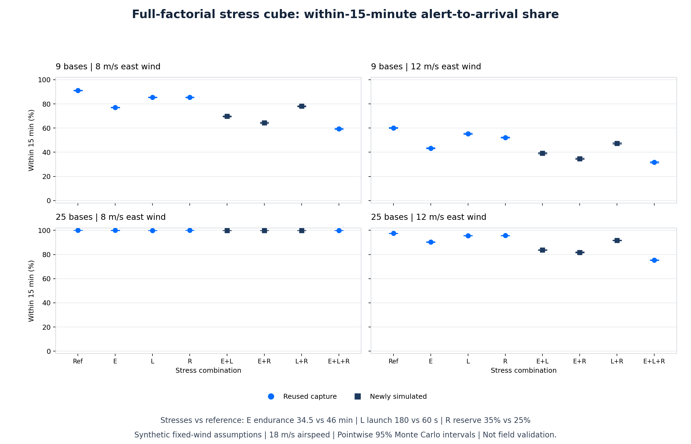

# Which Operating Assumptions Interact?

## Result

Completing the previous stress study exposes non-additive behavior inside the
synthetic dispatch model. At fixed 12 m/s wind with 25 bases, the endurance/reserve
interaction is **-5.5555 percentage points**, with a pointwise 95% Monte Carlo
interval of **[-5.8325, -5.2971]**. This is the full difference-in-differences,
averaged over the two launch settings, not a half-scaled orthogonal DOE effect.

That interaction is context-dependent. With 9 bases at the same wind it is
-0.2210 points, with interval [-0.5218, 0.0863]. Neither value establishes real
aircraft behavior: inputs remain hypothetical and the alerts synthetic.

This extension completes a design, not an independent replication. It reuses
all 20 captured scenarios from the [prior study](2026-11-08-robustness-study.md)
and dispatches only the 12 missing pairwise-stress combinations, against the
same 200 seasons and 61,084 real alerts per cell.



## Design

The [protocol](../factorial_protocol.json) and
[acceptance plan](2026-11-08-factorial-spec.md) precede implementation/execution.
Three two-level factors give eight cells in each of four layout/wind contexts:

| Factor | Reference (0) | Stress (1) |
| --- | ---: | ---: |
| E: airborne endurance | 46 min | 34.5 min |
| L: launch latency | 60 s | 180 s |
| R: battery reserve | 25% | 35% |

Contexts are 9 or 25 bases, each under fixed eastward wind of 8 or 12 m/s.
Airspeed remains 18 m/s, with one aircraft per base. Geometry, false-alert load,
dwell, turnaround, mission eligibility and dispatch policy are inherited
unchanged. The response clock starts at external alert receipt, not ignition.
Launch occupies aircraft busy time but is not airborne time in this model.

The existing dispatcher explicitly couples endurance and reserve through
`endurance_min * 60 * (1 - reserve_fraction)`, then applies a round-trip
eligibility threshold. This structural coupling motivates inspecting joint
constraints; it does not prove a particular physical failure mechanism in the
field.

## All Eight Cells

Values are pooled percentages of real alerts reached within 900 seconds.
Rejected missions remain in the denominator. False alerts consume fleet time
but are not counted as real-alert successes.

| Stress combination | 9 bases, 8 m/s | 9 bases, 12 m/s | 25 bases, 8 m/s | 25 bases, 12 m/s | Provenance |
| --- | ---: | ---: | ---: | ---: | --- |
| Reference | 91.04% | 60.10% | 99.99% | 97.48% | Reused |
| E | 77.06% | 43.37% | 99.97% | 90.23% | Reused |
| L | 85.51% | 55.26% | 99.90% | 95.61% | Reused |
| R | 85.45% | 52.19% | 99.99% | 95.69% | Reused |
| E+L | 69.77% | 39.21% | 99.88% | 83.76% | New |
| E+R | 64.33% | 34.67% | 99.94% | 81.80% | New |
| L+R | 78.13% | 47.37% | 99.90% | 91.67% | New |
| E+L+R | 59.36% | 31.67% | 99.85% | 75.34% | Reused |

Exact shares and marginal intervals are in
[`summary.csv`](../research_results/2026-11-08-factorial/summary.csv).
The chart reads those captured values only. Reused marginal intervals are
copied unchanged, not re-estimated.

## Main And Interaction Contrasts

For a selected subset S of the three factors, take its signed finite difference
and average over the other factors. Apply that contrast to timely counts in
each season, then divide summed signed counts by the shared real-alert total.
The protocol's coefficient for a cell is:

```text
(-1) ** (len(S) - sum(selected_bits)) / 2 ** (3 - len(S))
```

- A main contrast is stressed minus reference, averaged over all four settings
  of the other factors. It is not the one-factor-versus-reference comparison
  from the prior report.
- A pair contrast is the full difference-in-differences, averaged over the
  remaining factor. Negative values mean a more negative joint change than
  additive single-factor changes in that contrast.
- The triple contrast is the difference between the two conditional pair
  contrasts. It identifies dependence on the third setting, not an additional
  standalone performance loss.
- Positive interaction values do not mean that stress improves service.
  Interaction signs describe non-additivity, not the sign of the overall change.

### Main Contrasts

Point estimates in percentage points, for these declared stress magnitudes:

| Factor | 9 bases, 8 m/s | 9 bases, 12 m/s | 25 bases, 8 m/s | 25 bases, 12 m/s |
| --- | ---: | ---: | ---: | ---: |
| E | -17.3994 | -16.5002 | -0.0336 | -12.3310 |
| L | -6.2746 | -4.2024 | -0.0892 | -4.7095 |
| R | -9.0290 | -8.0119 | -0.0147 | -5.6467 |

At 12 m/s, E has the largest main contrast in both layouts. This ranking is
conditional on the chosen factor ranges, not a sensitivity per unit or a
universal ranking of engineering priorities.

### Endurance/Reserve Interaction

These are exploratory readings of the predeclared contrast set, not
confirmatory field hypotheses.

| Context | E+R full difference-in-differences (points) | Pointwise 95% MC interval |
| --- | ---: | --- |
| 9 bases, 8 m/s | -5.0873 | [-5.4286, -4.7715] |
| 9 bases, 12 m/s | -0.2210 | [-0.5218, 0.0863] |
| 25 bases, 8 m/s | -0.0246 | [-0.0400, -0.0122] |
| 25 bases, 12 m/s | -5.5555 | [-5.8325, -5.2971] |

Other interactions also change with context: at 12 m/s, E+L is +1.2458 points
for 9 bases but -3.5271 for 25 bases. The dense layout at 8 m/s is near the
metric ceiling across all eight cells, so its small differences should not
be generalized to harsher inputs.

All **28** estimates and intervals, including all four triple contrasts, are
reported without filtering in
[`effects.csv`](../research_results/2026-11-08-factorial/effects.csv).
No significance-based selection, p-value claim or multiple-comparison
guarantee is made.

## Uncertainty

Use 1,000 whole-season bootstrap draws, seeded `[1, 20261108]`, with identical
season indices for every cell. Recompute the event-weighted contrast on each
draw and report its linear 2.5/97.5 percentiles. Dependence between cells and
between alerts within the same season is preserved.

These are **pointwise Monte Carlo sampling intervals** under fixed simulation
assumptions, not simultaneous confidence coverage for 28 contrasts. They omit
uncertainty in aircraft inputs, geography, weather, alert processes and model
structure. A narrow interval is not evidence of real-world accuracy.

## Reproducibility And Integrity

```sh
.venv/bin/python factorial.py --output research-runs/my-factorial
.venv/bin/python render_factorial.py research-runs/my-factorial/summary.csv --output research-runs/my-factorial/factorial.png
```

Both output paths must be fresh. Retain the default source capture:
[`2026-11-08-robustness`](../research_results/2026-11-08-robustness/).
The extension deliberately does not duplicate its alert/response arrays.

The [manifest](../research_results/2026-11-08-factorial/manifest.json) fingerprints
the source manifest and five source artifacts, the executed scientific files,
four new artifacts, the inherited protocol/configuration, seed and environment.
It maps all 20 reused IDs and lists all 12 newly simulated IDs.

- `new_responses.npz`: only the 12 new real-alert response vectors and shared
  season offsets.
- `seasons.csv`: all 6,400 per-cell, per-season count rows.
- `summary.csv`: all 32 cells, with explicit reused/simulated provenance.
- `effects.csv`: all 28 contrast estimates and pointwise intervals.
- `factorial.png`: capture-only rendering, with categorical points and capped
  intervals, not fitted trends.

Analytic tests cover additive, pair and triple terms, event weighting and
paired resampling. A deliberately half-scaled estimator fails both pair/triple
analytic checks. A two-season fixture verifies that only missing cells invoke
dispatch. A separate raw-response audit reconstructs all 32 cells and all
28 contrasts using successive finite differences rather than the runner's
signed-coefficient implementation. Source artifacts remain unchanged.

## Boundaries And Next Evidence

This is a two-level local experiment, not optimization, a global sensitivity
analysis or an exhaustive operating envelope. Fixed winds are not weather
availability probabilities. The square domain omits terrain, obstacles,
communications, crew availability and regulatory restrictions. No real
endurance, launch measurements or detector accuracy is established.

Next priority is measured inputs and independently labelled recordings, not
further precision on the same assumptions. See the
[roadmap](research-roadmap.md) and [proposed field protocol](../field_protocol.json).
No flights, live control, hardware purchases or deployment are part of this work.

## Resume-Safe Description

> Developed a reproducible synthetic UAV alert-verification study with paired
> simulations and a full-factorial stress analysis; reused 20 captured
> scenarios, simulated 12 missing combinations and evaluated 28 main/interaction
> contrasts with whole-season bootstrap intervals.

Use only claims you can explain and substantiate, with collaboration/AI
assistance disclosed where relevant. Do not claim field validation, detector
accuracy, publication or autonomous deployment.
