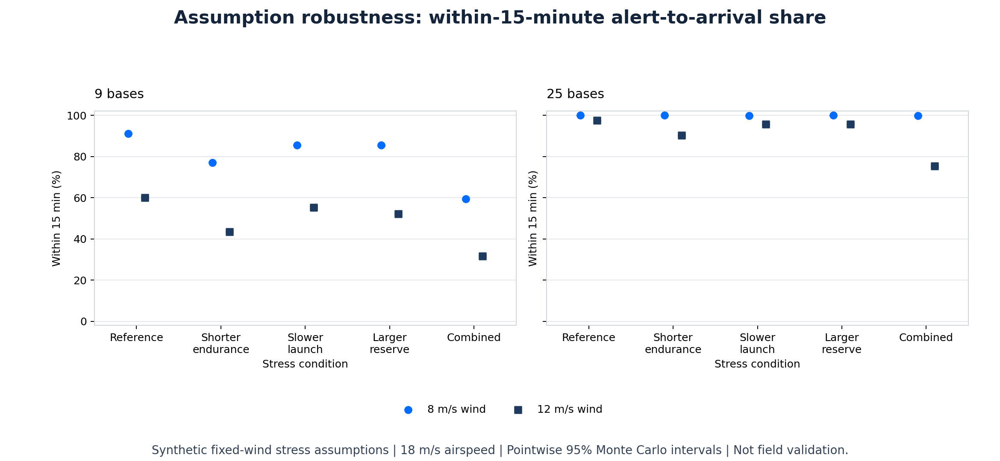

# How Fragile Is The Network-Density Result?

**Synthetic simulation study, 2026-11-08. Not field validation.**

## Finding

More bases retain a substantial simulated advantage under conservative
operating assumptions. They do not make the service estimate insensitive to
those assumptions.

At fixed 12 m/s wind and 18 m/s airspeed, the 25-base layout reaches **97.48%**
of real alerts within 15 minutes under reference assumptions. With shorter
endurance, a larger reserve and slower launches together, this becomes
**75.34%**. The corresponding 9-base result is **31.67%**.

The useful contribution is a reproducible assumption stress test, not a claim
that these percentages predict real wildfire operations.



## Question And Design

Does the benefit of a denser network persist when endurance, launch latency
and battery reserve become more conservative?

The [protocol](../robustness_protocol.json) and
[test-first specification](2026-11-08-robustness-spec.md) were authored before
the full run. This was not an externally preregistered experiment.

| Factor | Values |
| --- | --- |
| Network | 9 or 25 bases, one drone per base |
| Constant eastward wind | 8 or 12 m/s |
| Airspeed | 18 m/s |
| Reference | 46 min endurance, 25% reserve, 60 s launch |
| Shorter endurance | 34.5 min, otherwise reference |
| Slower launch | 180 s, otherwise reference |
| Larger reserve | 35%, otherwise reference |
| Combined | 34.5 min endurance, 35% reserve, 180 s launch |

These five conditions across two networks and two winds give **20 scenarios**.
The shorter endurance is a hypothetical 25% reduction, not measured aircraft
degradation. Reserve applies to the selected endurance: usable airborne time
is 34.5 minutes under reference assumptions and 22.425 minutes under combined
stress. Launch latency consumes fleet busy time, not airborne endurance.

All scenarios share **200 synthetic seasons**, containing **61,084 real
alerts and 10,880 false alerts**. These are common inputs, not 20 independent
datasets. The world remains a uniform 3,808 km² square with a 120-day season,
307 expected real ignitions per season and expected false-alarm fraction 0.15.
The actual counts describe this capture only.

The original `research.py` dispatcher, flight calculations, costs and legacy
results are unchanged. This run uses a new seed and a separate random-stream
namespace; its reference percentages need not exactly equal the earlier anchor.

## Captured Results

All percentages use every real alert in the denominator, including rejected
missions. Timely means arrival within 900 seconds of alert receipt, inclusive.
Upstream detection latency is excluded.

| Bases | Fixed wind | Condition | Timely share | 95% MC interval | Physically rejected |
| --- | ---: | --- | ---: | ---: | ---: |
| 9 | 8 m/s | Reference | 91.04% | 90.80-91.25% | 0.00% |
| 9 | 8 m/s | Combined | 59.36% | 58.98-59.75% | 34.66% |
| 25 | 8 m/s | Reference | 99.99% | 99.98-100.00% | 0.00% |
| 25 | 8 m/s | Combined | 99.85% | 99.82-99.88% | 0.00% |
| 9 | 12 m/s | Reference | 60.10% | 59.71-60.47% | 15.90% |
| 9 | 12 m/s | Combined | 31.67% | 31.29-32.04% | 62.70% |
| 25 | 12 m/s | Reference | 97.48% | 97.36-97.61% | 0.00% |
| 25 | 12 m/s | Combined | 75.34% | 75.04-75.66% | 11.06% |

The 100.00% interval endpoint above is rounded from 99.9967%, not proof of
perfect coverage. Full-precision values and all single-factor conditions are
in the [summary](../research_results/2026-11-08-robustness/summary.csv).

At 12 m/s under combined stress:

- Increasing density from 9 to 25 bases adds **43.66 percentage points**
  of timely service (paired 95% MC interval **43.22 to 44.14 points**).
- Within the 25-base layout, combined stress reduces timely service by
  **22.15 points** (paired interval **21.84 to 22.42 points of reduction**).
- Within the 9-base layout, the reduction is **28.43 points**
  (paired interval **28.06 to 28.79 points of reduction**).

Combined-stress pooled p90 is unreachable/infinite for both networks at
12 m/s because more than 10% of alerts are physically rejected. Rejected
alerts are not silently excluded from the response distribution.

Historical proxy model costs remain 100.98 and 252.48 EUR/km²/year for 9 and
25 bases respectively. These are not validated procurement estimates and
are not adjusted for the stressed operating assumptions.

## Method And Verification

The alert generator runs once. All layouts and conditions receive the exact
same real alerts and false-alert workload. Random streams use
`SeedSequence([0, season_index, seed])`; bootstrap draws use `[1, seed]`.

Uncertainty is estimated with 1,000 percentile bootstrap draws, sampling whole
seasons. Each paired contrast uses identical sampled season indices for both
arms. A draw's difference is:

```text
100 * sum(candidate_timely - reference_timely) / sum(real_alerts)
```

There are 16 stress-versus-reference contrasts and 10 density contrasts.
Intervals are pointwise, not simultaneous intervals across all 26 comparisons.
They quantify Monte Carlo sampling error only. They do not bound aircraft,
weather, geographic, cost or model uncertainty. A small interval does not make
the assumptions realistic.

Analytical counting and paired-resampling tests precede the run. A deliberately
unpaired bootstrap implementation fails the numerical test. Published integrity
tests check file hashes, raw response counts, pooled quantiles, all marginal
intervals and every paired contrast against the frozen arrays. No simulation
is rerun by rendering or integrity checks.

## Reproduce Or Inspect

The [frozen capture](../research_results/2026-11-08-robustness/) includes:

- `manifest.json`: protocol, inherited config, source/environment fingerprints
  and hashes of the five scientific data artifacts.
- `alerts.npz`: generated alert times, coordinates, truth flags and season offsets.
- `responses.npz`: real-alert responses for every scenario and common offsets.
- `seasons.csv`, `summary.csv`, `comparisons.csv`: inspectable numeric evidence.
- `stress.png`: a separate rendering of the captured summary.

Run the existing environment setup in the [README](../README.md#reproduce).
Use fresh output paths:

```sh
.venv/bin/python robustness.py --output research-runs/my-robustness --seasons 200 --seed 20261108
.venv/bin/python render_robustness.py research-runs/my-robustness/summary.csv --output research-runs/my-robustness/stress.png
make verify
```

The capture records Python 3.13.12 and NumPy 2.2.6. Seeded replay is subject
to the recorded software versions; exact cross-version random-stream identity
is not promised. Git revision identifies the parent commit because the run
preceded the publishing commit; source hashes identify the executed files.

## Source Check And Evidence Boundaries

The [manufacturer's Dock 3 specifications](https://enterprise.dji.com/dock-3/specs),
accessed 2026-11-08 through the public page-reader route, list 12 m/s maximum
wind resistance and 54 minutes maximum flight time. The flight-time test is
specified at 12 m/s forward speed, windless conditions, and 100% to 0% battery.
Those conditions are not this model's 18 m/s mission with reserve.

The study's inherited 46-minute assumption is therefore a model input, not a
claim to reproduce that manufacturer's current maximum-flight-time figure.
Neither a rated wind limit nor laboratory flight time validates routine
operating coverage. None of the stress values is empirically calibrated.

[NumPy's parallel random-number guidance](https://numpy.org/doc/stable/reference/random/parallel.html)
supports structured seed sequences for reproducible, separated streams.
The paired estimator and its checks are explicit project code, not an opaque
statistics package.

This is an assumption stress study, not global sensitivity analysis, a full
factorial experiment, or optimization. The single-factor conditions plus one
combined condition do not identify all interactions. Fixed winds do not
represent weather frequencies, gusts, temporal correlation or fire-weather
coupling. The model still excludes terrain, obstacles, battery temperature,
power/drag modelling, realistic alert clustering and staffing constraints.
No detector accuracy, field readiness or operational authorization is claimed.

## Next Evidence

1. Measure usable mission endurance and launch latency under an authorized,
   conservative VLOS protocol before interpreting any scenario as operational.
2. Replace assumed battery/time budgets with measured distributions, retaining
   reserve and weather exclusions.
3. Add historical weather and clustered alert inputs only after checking the
   time-varying model against measured behavior.
4. Evaluate recorded-video event episodes once independent labelled recordings
   exist. This simulation does not validate the RGB detector.

## Resume-Safe Description

Use only claims you can explain and defend:

> Developed a reproducible Python research prototype for drone-supported
> wildfire-alert verification, modelling wind-aware dispatch, battery reserves
> and fleet contention; conducted a 20-scenario stress study over 200 shared
> Monte Carlo seasons with paired season-bootstrap comparisons and captured
> input/output provenance.

Describe it as a simulation research project, not a deployed detection system,
field trial, published paper, validated accuracy result or sole-author effort
if those descriptions are not true. Be ready to explain common random inputs,
rejected-alert denominators, paired versus unpaired intervals and why narrow
Monte Carlo intervals do not establish real-world performance.
