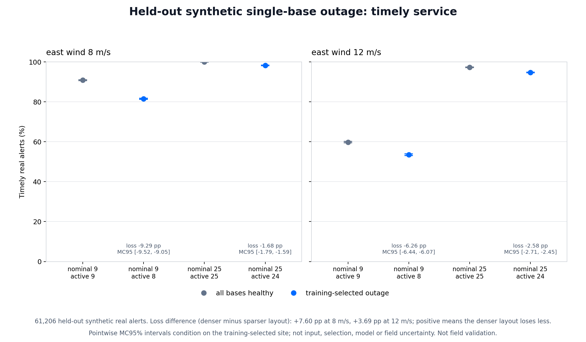
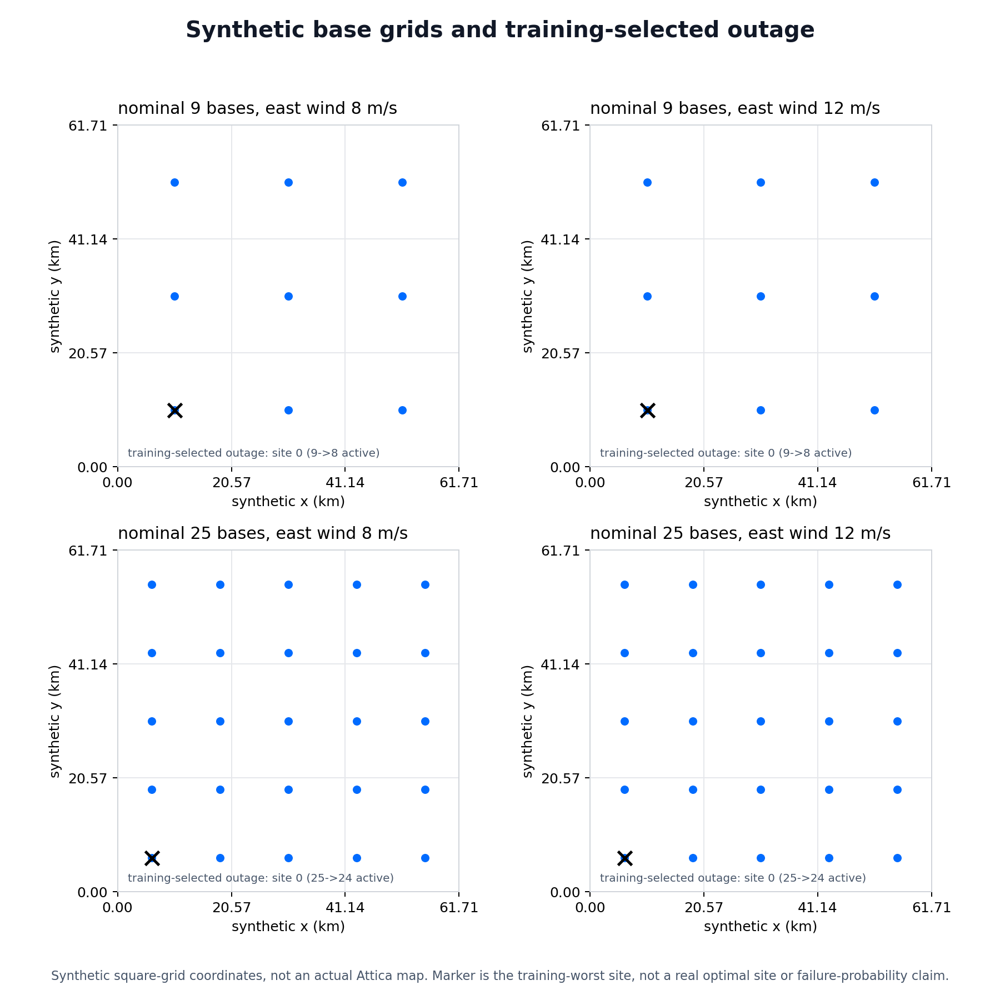

# Held-out network resilience: one base unavailable

## Question And Result

How much timely service is lost when a training-identified critical base goes
offline, and does the denser layout lose less?

At fixed 12 m/s east wind, removing the selected base reduces timely arrivals
by **6.26 percentage points for the 9-base layout**, versus **2.58 points for
the 25-base layout**. The paired difference in losses is **3.69 points**
(pointwise 95% Monte Carlo interval: **3.49 to 3.87**), favoring the denser layout.

These are held-out synthetic results, not observed outages or field performance.
The denser layout has more infrastructure and loses a smaller fraction of its
fleet when one site fails. This is not equal-budget or equal-fraction-failure
optimization, and it does not isolate a per-aircraft redundancy benefit.



## Held-Out Evidence

| Nominal bases | Fixed east wind | Healthy timely share | Selected-outage timely share | Outage minus healthy | Pointwise MC95% interval |
| ---: | ---: | ---: | ---: | ---: | --- |
| 9 | 8 m/s | 90.88% | 81.59% | -9.29 pp | -9.52 to -9.05 pp |
| 25 | 8 m/s | 99.99% | 98.31% | -1.68 pp | -1.79 to -1.59 pp |
| 9 | 12 m/s | 59.81% | 53.55% | -6.26 pp | -6.44 to -6.07 pp |
| 25 | 12 m/s | 97.33% | 94.75% | -2.58 pp | -2.71 to -2.45 pp |

All eight healthy/outage cases share **200 fresh held-out seasons** and
**61,206 simulated real alerts**. Here "real" means the generator's true-alert
flag, not actual fires or independently labelled recordings. Additional
simulated false alerts consume fleet capacity but are excluded from the
true-alert outcome denominator.

The 25-base layout loses **7.60 points less at 8 m/s** (MC95%: 7.37 to 7.82)
and **3.69 points less at 12 m/s**. These are paired differences in outage
losses, not differences between independently estimated interval endpoints.

The smaller additional loss for the 9-base layout at 12 m/s does not mean
stronger service: its healthy baseline already serves fewer alerts. Its
post-outage share is 53.55%, versus 81.59% at 8 m/s.

Exact, unrounded values:
[summary](../research_results/2026-11-09-resilience/summary.csv),
[six contrasts](../research_results/2026-11-09-resilience/contrasts.csv).

## Selection Without Test-Set Tuning

Thirty training seasons evaluate every single-site outage in both layouts
and winds, plus healthy references: **72 training cases**. Within each
layout/wind, the selected site minimizes pooled timely true-alert count.
Ties choose the lowest original row-major base index.

The selection CSV and its SHA-256 are frozen before held-out alerts are
generated. Held-out evaluation includes only four healthy references and
their four selected outages. Test outcomes do not select a replacement site.

Site0 was selected in all four training contexts. Its coordinates are
synthetic grid locations, not recommendations for real facilities. A
training-selected worst site is not necessarily the worst on held-out data
or under a different spatial distribution.



## Methods

- Same existing wind-aware, reserve-constrained dispatcher and alert generator.
- Nominal layouts: 9 or 25 cell-centred sites, one drone per site. Outage
  removes one site and its drone for the whole season: 8 or 24 remain active.
- Airspeed18m/s, endurance46min, reserve25%, launch60s, fixed east wind8/12m/s,
  maximum model wind12m/s. Other values remain in captured
  [config.json](../research_results/2026-11-09-resilience/config.json).
- Uniform alerts over a 3,808km2 synthetic square and 120-day season;
  307 expected true alerts per season, false-alert share15%.
- Root seed2026110901; training uses SeedSequence([0,season,seed]),
  held-out uses SeedSequence([1,season,seed]). Earlier studies' alerts are
  not reused. All candidates within a phase see identical alerts.
- Outcome: pooled proportion of all true alerts reached within900 seconds
  of alert receipt. Rejected missions remain failures in the denominator.
  Upstream detection latency and thermal-confirmation time are not included.
- Four outage-minus-healthy contrasts. Two interaction-style comparisons:
  (outage25-healthy25)-(outage9-healthy9). Positive values mean less loss
  in the denser layout.
- One shared1,000x200 season-index bootstrap matrix, seeded [2,seed].
  Every arm uses identical season draws and denominator weights. Intervals
  are pointwise percentile2.5/97.5%, conditional on frozen training selection.

The [protocol](../resilience_protocol.json) and
[test-first specification](2026-11-09-resilience-spec.md) were defined before
execution; this was not externally preregistered.

## Reproduce And Audit

```sh
.venv/bin/python resilience.py --output research-runs/NEW_RESILIENCE_RUN
.venv/bin/python verify_capture.py research_results/2026-11-09-resilience
.venv/bin/python render_resilience.py --run research_results/2026-11-09-resilience --output research-runs/NEW_RESILIENCE_FIGURES
```

Use fresh output paths. Do not regenerate the published frozen study.
The capture includes both phases' alerts, every response vector, every
per-season count, candidate geometries, frozen selection, exact bootstrap
indices, source fingerprints and artifact hashes. The separate figures
manifest binds image bytes to the numerical capture manifest.

Independent raw-capture audit checked all per-season counts, eight rates,
six paired intervals, four training-only selections and exact bootstrap
indices. All230 season inputs matched their declared random streams.
Eight first-season physical-dispatch replays matched stored responses.
No simulator is imported or rerun by the renderer.

## Limits And Next Evidence

No measured failure probability or repair duration is assigned. A season-long
single-site outage is a deterministic stress scenario, not an uptime forecast.
There is no spare-aircraft relocation, correlated outage, real site constraint,
terrain, nonuniform ignition risk or time-varying wind.

Intervals quantify Monte Carlo sampling only, not selection uncertainty,
input uncertainty, model error, simultaneous coverage or field uncertainty.
The experiment does not establish optimal real sites, sufficient operational
coverage, detector accuracy, regulatory readiness or authorization to fly.

Useful follow-ups: equal-fraction outage comparisons to separate capacity
effects, spatially heterogeneous alert scenarios, then measured availability
and response inputs. Independently labelled lawful footage remains a separate
validation requirement.

## Resume-Safe Description

Built a reproducible synthetic drone-network resilience benchmark using
training-selected base-outage scenarios, 200 held-out seasons, wind/battery
constraints and paired season-bootstrap uncertainty. Published raw captures,
site maps, response comparisons and explicit non-field-validation limits.
