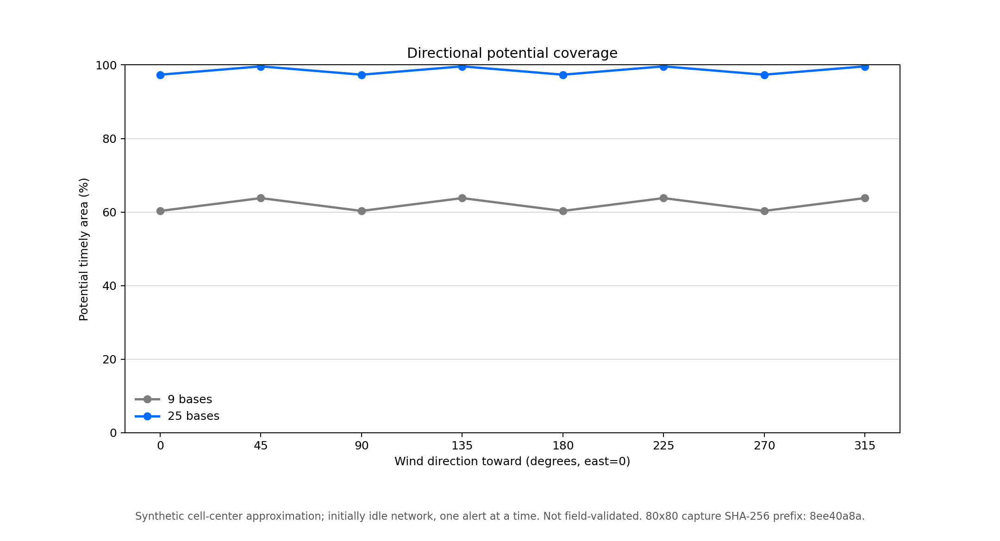
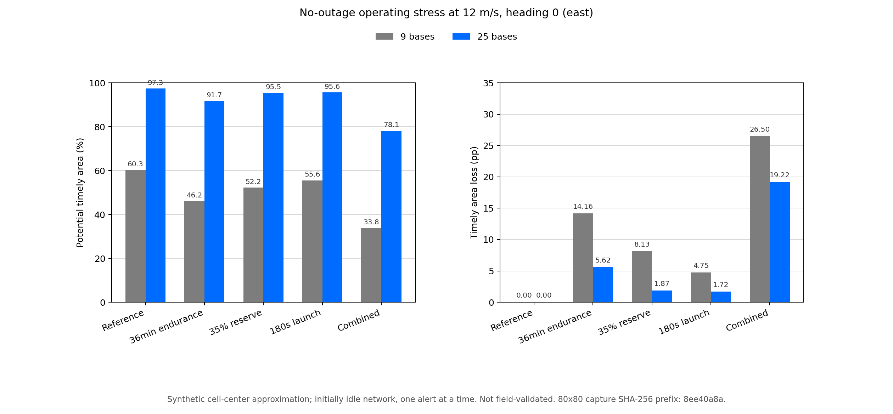

# Directional Coverage And Outage Atlas

## Research Question

Where can an initially idle network reach an alert within 15 minutes, and how
does that potential area change with wind direction, unavailable sites and
operating assumptions?

This is a spatial study, not a rerun or replacement of the earlier seasonal
experiments. It adds no field validation or detector-accuracy evidence.

## Design

The [numerical protocol](2026-11-10-coverage-study-protocol.md) specifies 388
scenarios, each captured at 40x40, 80x80 and 160x160 cell-center resolutions.
That is 13,036,800 independent, initially idle single-alert evaluations across
the three grids, not that many observed fires or queued seasonal missions.

- 288 reference cases: eight 12 m/s wind directions, two layouts, healthy
  networks and every individual site outage.
- 32 selected two-site outage cases, not all pairs or worst-pair optimization.
- 64 healthy stress cases: shorter endurance, greater reserve, slower launch,
  and their combination.
- Two healthy calm cases and two 13 m/s weather-closure cases.

Reference assumptions remain 18 m/s airspeed, 46-minute endurance, 25% reserve
and 60-second launch latency. Stress changes endurance to 36 minutes, reserve
to 35%, launch latency to 180 seconds, or all three together. Wind headings
describe the direction toward which wind blows: east=0, north=90.

All points use the existing outbound/return flight model and battery rules.
There is no queueing, terrain, ignition-risk weighting or weather probability.
Denser layouts use more infrastructure; this is not an equal-budget comparison.

## Captured Findings

The default interactive grid is 80x80. Percentages below approximate equal-area
coverage; they are not probabilities of detecting a fire or season service rates.

At a fixed 12 m/s wind toward the east:

| Layout | Reference timely area | Combined-stress timely area | Loss |
|---|---:|---:|---:|
| 9 bases | 60.3% | 33.8% | 26.5 percentage points |
| 25 bases | 97.3% | 78.1% | 19.2 percentage points |

For that same eastward reference wind, the largest observed single-outage loss
among every individually unavailable site is 6.45 percentage points with
9 bases and 2.64 points with 25 bases. Among only the two declared outage
pairs, the larger loss is 12.86 and 5.28 points respectively, in both cases
for sites [0,1]. These are descriptive results on the declared grid, not
held-out site selection, exhaustive multi-outage robustness or field guarantees.

Across the eight reference wind directions, healthy potential timely area ranges
from 60.3% to 63.8% for 9 bases and 97.3% to 99.6% for 25 bases. Direction can
matter even at a fixed wind magnitude; the square/grid geometry is itself a
strong simplifying assumption.

## Captured Figures





These figures read the frozen analysis summary, not a new simulation.
The [figure receipt](../research_results/2026-11-10-coverage-figures/provenance.json)
records input and image hashes and the exact renderer version used.

## Numerical Sensitivity

Every one of the 388 scenarios was checked at all three resolutions. The
maximum absolute difference in potential timely area over the matrix was:

| Comparison | Largest observed difference |
|---|---:|
| 40x40 minus 160x160 | 3.63 percentage points |
| 80x80 minus 160x160 | 0.94 percentage points |

The 160x160 grid is a finer comparison, not ground truth. These differences
are not confidence intervals, formal error bounds or a guarantee of monotonic
convergence. Avoid treating cell-level boundaries or excess displayed decimal
precision as a deployment guarantee.

## Reproduce Without Overwriting

Run only into fresh directories. Existing captures are frozen.

```sh
mkdir -p research-runs
.venv/bin/python coverage_capture.py --output research-runs/atlas-g40 --grid-n 40
.venv/bin/python coverage_capture.py --output research-runs/atlas-g80 --grid-n 80
.venv/bin/python coverage_capture.py --output research-runs/atlas-g160 --grid-n 160
.venv/bin/python coverage_study.py \
  --capture40 research-runs/atlas-g40 \
  --capture80 research-runs/atlas-g80 \
  --capture160 research-runs/atlas-g160 \
  --output research-runs/atlas-analysis
```

Published captures are under `research_results/2026-11-10-coverage-grid40`,
`research_results/2026-11-10-coverage-atlas-v1` and
`research_results/2026-11-10-coverage-grid160`. Frozen derived tables and plot
inputs are under `research_results/2026-11-10-coverage-analysis`.

The vectorized engine passes 120 detailed comparisons with the existing
dispatcher, an additional independent point in every scenario, and deadline/
battery boundary checks. A deliberately wrong return leg fails the existing
oracle test. Altered bytes and rehashed-but-inconsistent summary values are
rejected. Source, scenario, archive and analysis hashes are recorded.

The numerical captures and audit are complete. The separate explorer gate
also passes: 378 Python tests, 66 JavaScript tests, real CLI/HTTP checks,
desktop/mobile browser workflows and deliberate cache/provenance failures.
These software checks are not additional scientific or field validation.

## Resume-Safe Description

Built a reproducible wildfire-drone coverage study spanning 388 wind, outage
and operating-stress scenarios at three spatial resolutions. Validated a
vectorized single-alert engine against an existing dispatcher and published
source-bound captures with numerical-sensitivity checks.

No operational deployment, field-performance or detector-accuracy claim.
